# EarthVision — Orbital Observation & Satellite Digital Image Processing (DIP) Platform

EarthVision is a production-grade Earth observation and satellite image processing web application. It combines a real 3D CesiumJS globe with true-color Esri World Imagery basemaps, click-to-2D-image capture, 24 digital image processing (DIP) algorithms powered by OpenCV and scikit-image, real-time radiometric metrics, session history, and full cloud deployment readiness.

---

## 📸 Application Interface Showcase

### 🌍 Front Page — EarthVision Landing & Observation Console

*Landing page with interactive canvas orbit tracker, coordinate query console, live target presets, and scientific pipeline architecture.*

---

### 🛰️ Interactive 3D Globe & DIP Analysis Studio

| 3D CesiumJS Earth Explorer | Interactive DIP Studio Workspace |
|:---:|:---:|
| 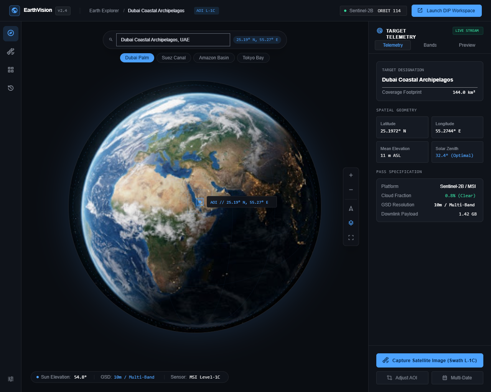 | 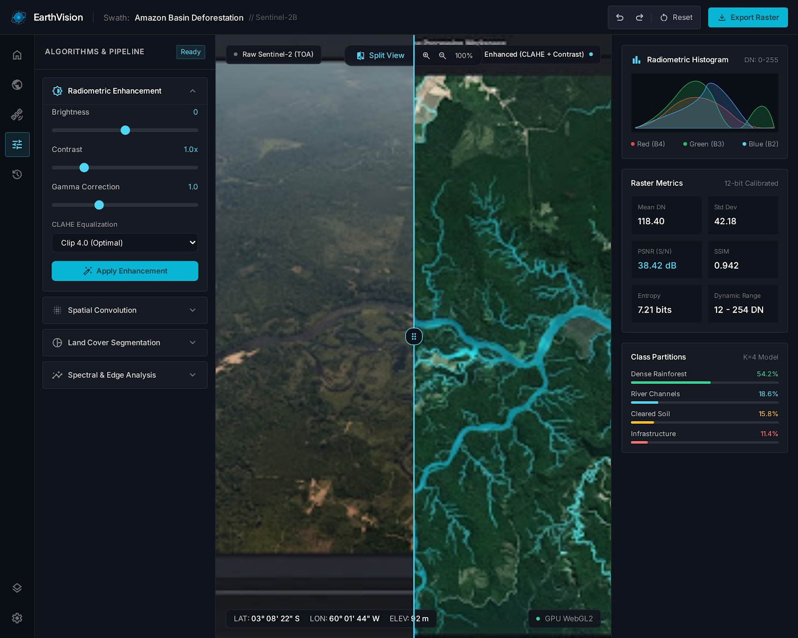 |
| *Full 360° virtual globe with live solar angles, diurnal shadow terminator, and coordinate lock* | *Dual-layer split comparison slider, live pixel inspection, 4-channel histograms & scientific metrics* |

---

## 🔬 Core Scientific Modules & Image Processing Results

### 1. Radiometric & Contrast Enhancement
Enhances optical dynamic range, reveals details in deep shadows, and balances solar illumination variations.

| Original Raw Swath | CLAHE 2.0 (Local Adaptive) | Global Histogram Equalization | Percentile Contrast Stretch |
|:---:|:---:|:---:|:---:|
|  | 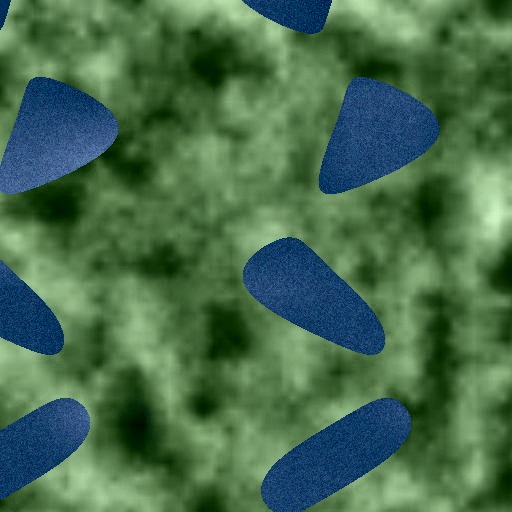 | 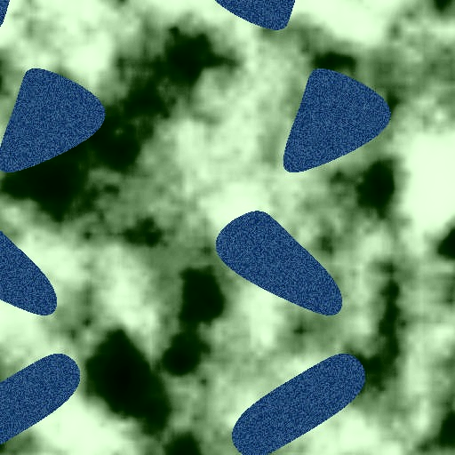 | 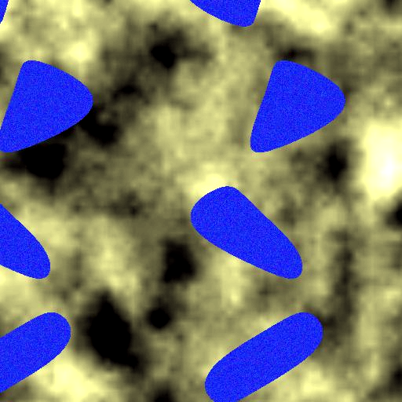 |
| *Baseline Esri satellite swath* | *Local tile histogram clipping* | *Y-channel CDF flattening* | *p2–p98 percentile stretch* |

---

### 2. Spatial Filtering & Noise Reduction
Suppresses sensor transmission artifacts, Gaussian noise, and atmospheric turbulence while re-sharpening blurred features.

| Original Raw Swath | Gaussian Spatial Smoothing | Median Filter (Denoise) | Unsharp Mask Sharpening |
|:---:|:---:|:---:|:---:|
|  | 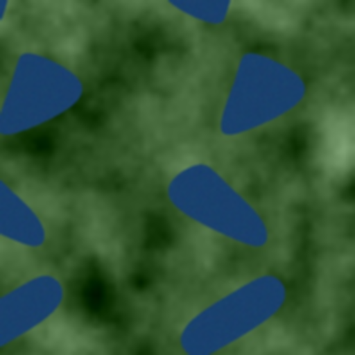 | 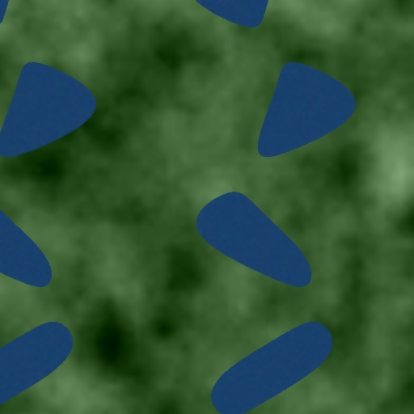 |  |
| *Input with sensor noise* | *Isotropic 2D normal distribution* | *Non-linear impulse noise removal* | *High-frequency detail boost* |

---

### 3. Edge & Feature Extraction
Delineates geological faults, coastal boundaries, canal edges, breakwaters, and urban transportation grids.

| Original Raw Swath | Sobel First-Order Gradient Magnitude | Canny Multi-Stage Hysteresis Edges |
|:---:|:---:|:---:|
|  | 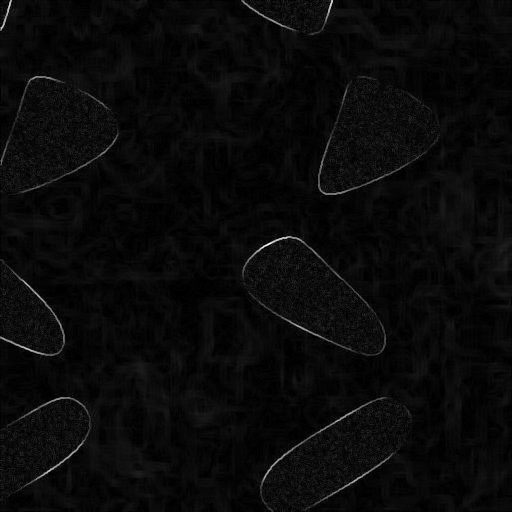 | 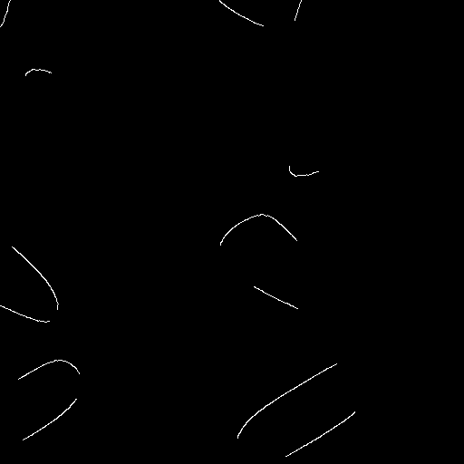 |
| *True-color satellite capture* | *$\|\nabla f\| = \sqrt{G_x^2 + G_y^2}$ discrete derivative* | *Non-max suppression + dual threshold hysteresis* |

---

### 4. Land Cover Segmentation & Thresholding
Partitions complex satellite scenes into discrete thematic surface classes (water bodies, built-up infrastructure, soil, and vegetation).

| Otsu Optimal Variance Threshold | Adaptive Local Threshold | K-Means Unsupervised Clustering (k=4) | Otsu Mask Region Highlight |
|:---:|:---:|:---:|:---:|
| 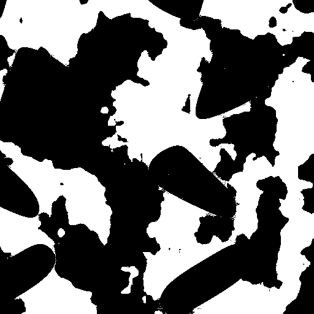 | 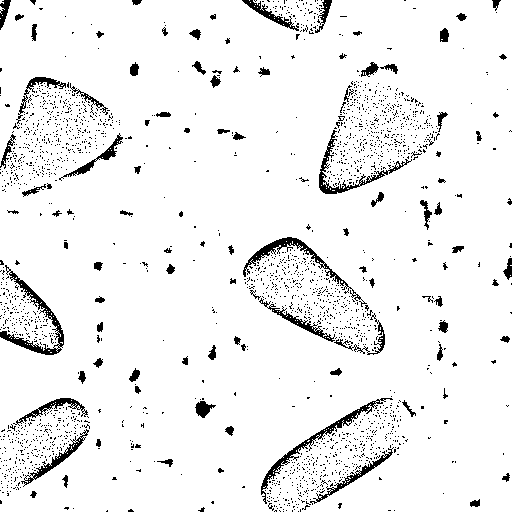 | 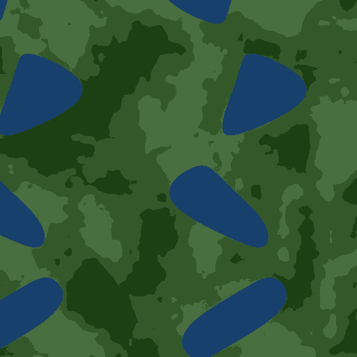 | 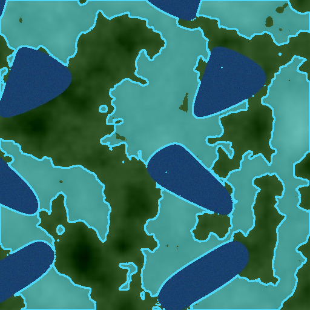 |
| *Max inter-class variance $\sigma_B^2$* | *Gaussian local neighborhood cutoff* | *3D RGB color clustering with % legend* | *Cyan overlay on segmented landmass* |

---

### 5. Mathematical Morphology
Cleans binary/grayscale masks, strips isolated transmission artifacts, fills structural cavities, and bridges fragmented linear features.

| Morphological Erosion | Morphological Dilation | Morphological Opening | Morphological Closing |
|:---:|:---:|:---:|:---:|
| 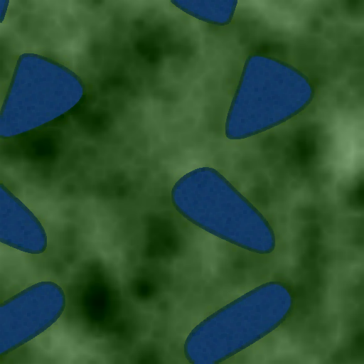 | 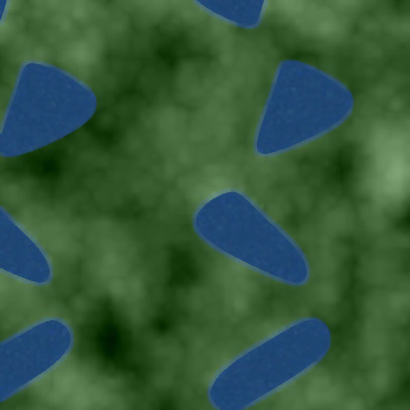 | 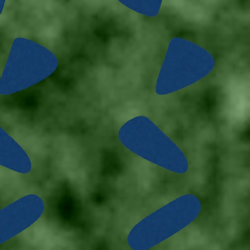 |  |
| *Strips noise & shrinks objects: $A \ominus B$* | *Bridges gaps & expands objects: $A \oplus B$* | *Erosion $\rightarrow$ Dilation (cleans specks)* | *Dilation $\rightarrow$ Erosion (fills holes)* |

---

### 6. Spectral Radiometry & Band Analysis
Decomposes multispectral optical bands and derives visible-spectrum vegetation indices.

| True-Color RGB Original | Luminance Grayscale | Extracted Green Band (560nm) | Excess Green Vegetation Proxy |
|:---:|:---:|:---:|:---:|
|  | 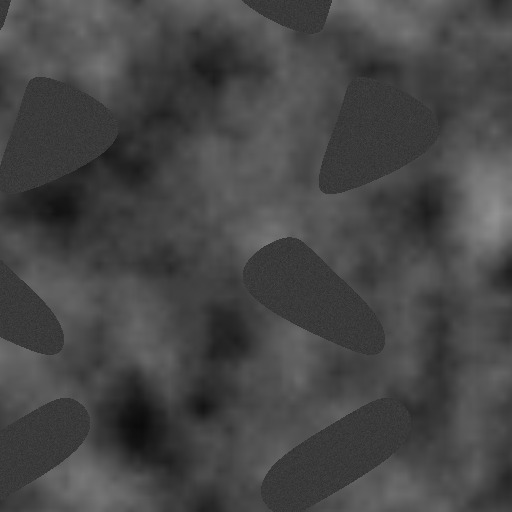 | 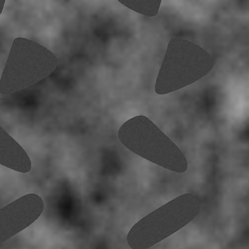 | 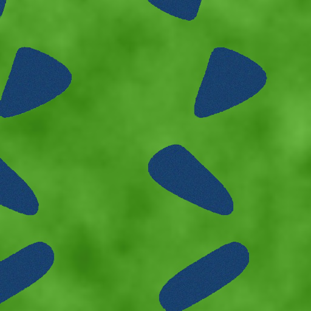 |
| *3-channel optical tensor* | *ITU-R BT.601 weighted luminance* | *Single-channel spectral reflectance* | *Excess Green ($2G - R - B$) vegetation proxy* |

---

## 🏗️ Architecture & Technology Stack

| Layer | Technology | Details |
|---|---|---|
| **Frontend Framework** | Vanilla HTML5 / ES6 JavaScript | Native ES6 modules, lightweight and zero-bloat |
| **Styling** | Tailwind CSS & Google Material Symbols | High-contrast geospatial glassmorphism theme |
| **3D Engine** | CesiumJS v1.121 (No Ion Token Required) | Photorealistic lighting, day/night terminator, atmosphere, starfield |
| **Imagery Basemap** | Esri World Imagery (True-Color RGB) | Real satellite tiles (0.5m – 1.0m / pixel) |
| **Night Lights** | NASA GIBS VIIRS Black Marble | Blended dynamically on the night-side terminator |
| **State Management** | Reactive `EarthVisionState` Store | Cross-page synchronization + browser `localStorage` persistence |
| **Build & Dev Proxy** | Multi-threaded Python Dev Server / Vite v5 | Serves frontend on `:3000`, proxies `/api/*` to `:8080` |
| **Backend Framework** | FastAPI (Python 3.10+) | Asynchronous REST gateway running on port `:8080` |
| **DIP & Vision Engine** | OpenCV 4.10+ & scikit-image | 24 algorithms, multi-stage pipeline chaining, PSNR/SSIM, Shannon entropy |

---

## 🚀 Quickstart Guide

### 1. Prerequisites
- Python 3.10+
- (Optional) Node.js 18+ (if building via Vite)

### 2. Launch Full Application (One-Click)
```bash
# Terminal 1: Start FastAPI Backend (Port 8080)
cd backend
python -m uvicorn main:app --host 0.0.0.0 --port 8080

# Terminal 2: Start Multi-threaded Frontend Server (Port 3000)
python dev_server.py
```
Open **`http://localhost:3000`** in your browser. All `/api/*` calls will be automatically proxied to `http://localhost:8080`.

### 3. Running Automated Tests
```bash
pytest backend/tests/ -v
```

---

## 🛰️ 24 DIP Algorithms Specification Contract

All algorithms clamp to these ranges, accept both color and single-channel inputs, and preserve spatial dimensions.

| # | Algorithm Key | Parameters (Types, Clamped Ranges, Defaults) | Description / Mathematical Principle |
|---|---|---|---|
| 1 | `brightness` | `value` (-100 to 100, default 0) | Offset addition: `np.clip(img + value, 0, 255)` |
| 2 | `contrast` | `value` (0.2 to 3.0, default 1.0) | Scaling relative to midtone (128): `128 + value * (img - 128)` |
| 3 | `gamma` | `gamma` (0.2 to 3.0, default 1.0) | Power law lookup table: `255 * (DN/255)^(1/gamma)` |
| 4 | `hist_eq` | *None* | Luminance-only equalization (YCrCb space) to preserve color fidelity |
| 5 | `clahe` | `clip` (1.0 to 10.0, def 2.0), `tile` (2 to 16, def 8) | Contrast Limited Adaptive Histogram Equalization on L channel |
| 6 | `contrast_stretch`| `low` (0 to 49, def 2), `high` (51 to 100, def 98) | Per-channel percentile dynamic range stretching |
| 7 | `gaussian` | `ksize` (3 to 31 odd, def 5), `sigma` (0 to 10, def 0) | Gaussian low-pass spatial smoothing convolution |
| 8 | `median` | `ksize` (3 to 15 odd, def 5) | Non-linear median filter for salt-and-pepper noise reduction |
| 9 | `mean` | `ksize` (3 to 31 odd, def 5) | Uniform box blur filter |
| 10 | `sharpen` | `amount` (0 to 5.0, def 1.0), `sigma` (0.5 to 5, def 2) | High-pass unsharp mask enhancement |
| 11 | `gray_threshold` | `method` (`otsu` or `manual`), `value` (0 to 255, def 127) | Binary segmentation yielding strictly 0 and 255 |
| 12 | `adaptive_threshold`| `block` (3 to 99 odd, def 35), `c` (-20 to 20), `method` (`gaussian` or `mean`) | Locally adaptive binarization |
| 13 | `kmeans` | `k` (2 to 8, def 4) | Deterministic seed k-means clustering; chunked for memory safety |
| 14 | `region_highlight` | `invert` (bool, def false) | Otsu region contour delineation with cyan translucent overlay |
| 15 | `grayscale` | *None* | Single-channel luminance conversion |
| 16 | `rgb_channel` | `channel` (`r`, `g`, or `b`, def `g`) | Exact channel separation |
| 17 | `sobel` | `ksize` (1, 3, 5, 7, def 3) | Normalized gradient magnitude $\sqrt{G_x^2 + G_y^2}$ |
| 18 | `canny` | `low` (0 to 255, def 100), `high` (0 to 255, def 200) | Two-threshold hysteresis edge detection (auto-swaps if reversed) |
| 19 | `histogram` | *None* | Returns input unchanged with updated telemetry histograms |
| 20 | `vegetation_proxy`| *None* | Excess Green Index ($2G - R - B$) RGB proxy (honestly labelled "not NDVI") |
| 21 | `erosion` | `ksize` (3 to 15 odd, def 3), `iterations` (1 to 5, def 1) | Morphological erosion: strips noise and shrinks white boundaries: $A \ominus B$ |
| 22 | `dilation` | `ksize` (3 to 15 odd, def 3), `iterations` (1 to 5, def 1) | Morphological dilation: expands regions and fills small gaps: $A \oplus B$ |
| 23 | `morph_open` | `ksize` (3 to 15 odd, def 3) | Morphological opening (Erosion $\rightarrow$ Dilation): eliminates speckles |
| 24 | `morph_close` | `ksize` (3 to 15 odd, def 3) | Morphological closing (Dilation $\rightarrow$ Erosion): closes holes & bridges |

---

## 📡 API Reference

- **`GET /api/health`**: Returns service status and version (`2.4.0`).
- **`GET /api/reverse?lat={lat}&lon={lon}`**: Reverse geocoding via OpenStreetMap Nominatim with in-memory caching.
- **`GET /api/geocode?q={query}`**: Location suggestion autocomplete (debounced 400ms on frontend).
- **`GET /api/elevation?lat={lat}&lon={lon}`**: Ground surface elevation lookup in meters.
- **`GET /api/capture?lat={lat}&lon={lon}&radius_km={r}`** or **`&bbox={minLon,minLat,maxLon,maxLat}`**:
  - Downlinks and stitches real Esri World Imagery tiles.
  - Returns raw JPEG image with `X-Meta` JSON header containing metadata.
  - Maximum BBox area: 2,500 km².
- **`POST /api/process`**:
  - Accepts JSON or multipart form containing algorithm key, parameters, and base64/binary image.
  - Returns processed data URL, execution `time_ms`, per-channel histograms, statistics, legend, and metrics:
    - **Entropy**: Shannon entropy in bits ($0.0 - 8.0$)
    - **Dynamic Range**: Minimum and maximum DN values
    - **PSNR & SSIM**: Computed via `scikit-image` for radiometric and filter algorithms (strictly `null` for segmentation and edge detectors).

---

## ⚖️ Scientific Rigor & Disclosures

- **Imagery Provider**: Esri World Imagery (True-Color RGB optical basemap, 0.5m–1.0m/pixel GSD).
- **Solar Geometry**: Sun elevation and zenith angles calculated live using Spencer/Cooper solar trigonometry equations.
- **Vegetation Index**: Excess Green ($2G - R - B$) is rigorously labelled as an optical vegetation proxy (acknowledging true NDVI requires Near-Infrared sensors).
- **Unsupervised Classes**: K-Means partitions are reported with exact pixel percentages and customizable class labels.

---

## 📄 License
MIT License. Esri World Imagery tiles © Esri, Maxar, Earthstar Geographics, and GIS User Community.
